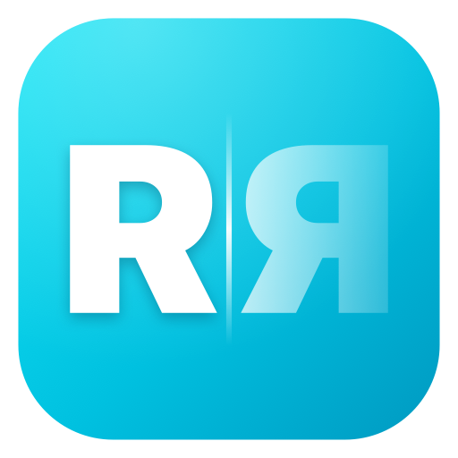

<p align="center">
  
</p>

<h1 align="center">Ronic Mirror</h1>

<p align="center">
  <b>Transforme o seu iPad em um segundo monitor de verdade, pelo Wi-Fi.</b><br>
  Tela <b>estendida</b> (não é espelhamento) · sem cabo · sem app no iPad · sem conta
</p>

<p align="center">
  <a href="https://github.com/jhowmael/Ronic---Mirror/releases/latest/download/RonicMirror-macOS.zip">
    
  </a>
  &nbsp;
  <a href="https://github.com/jhowmael/Ronic---Mirror/releases/latest/download/RonicMirror-Windows.zip">
    
  </a>
</p>

<p align="center">
  <a href="https://github.com/jhowmael/Ronic---Mirror/releases">Todas as versões</a> ·
  <a href="#como-usar">Como usar</a> ·
  <a href="#compilar-a-partir-do-código">Compilar</a> ·
  <a href="docs/PROTOCOL.md">Protocolo</a>
</p>

---

## Downloads

| Sistema | Arquivo | Requisitos |
|---|---|---|
| **macOS** (Apple Silicon e Intel) | [`RonicMirror-macOS.zip`](https://github.com/jhowmael/Ronic---Mirror/releases/latest/download/RonicMirror-macOS.zip) | macOS 13 Ventura ou mais recente |
| **Windows** (64 bits) | [`RonicMirror-Windows.zip`](https://github.com/jhowmael/Ronic---Mirror/releases/latest/download/RonicMirror-Windows.zip) | Windows 10 (19H2+) ou Windows 11 |
| **iPad** | Nada para instalar: use o Safari | iPadOS 15 ou mais recente |

O computador e o iPad precisam estar **na mesma rede Wi-Fi**.

## Como usar

### macOS

1. Baixe e descompacte `RonicMirror-macOS.zip`. Arraste **RonicMirror.app** para **Aplicativos**.
2. Abra o app. Na primeira vez, o macOS pode bloquear: vá em **Ajustes do Sistema › Privacidade e Segurança** e clique em **Abrir Mesmo Assim**. Se preferir o Terminal: `xattr -dr com.apple.quarantine /Applications/RonicMirror.app`.
3. Permita a **Gravação de Tela**: em **Ajustes do Sistema › Privacidade e Segurança › Gravação de Tela e Áudio do Sistema**, ative **RonicMirror** e clique em **Reabrir app**.
4. Se o firewall perguntar se `core-server` pode receber conexões, clique em **Permitir**.

### Windows

1. Baixe e descompacte `RonicMirror-Windows.zip` em qualquer pasta (por exemplo, `C:\Ronic Mirror`).
2. Abra **RonicMirror.exe**. Se o SmartScreen avisar, clique em **Mais informações › Executar assim mesmo**.
3. Na primeira vez, clique em **Instalar driver** e confirme o pedido de administrador. É o driver de monitor virtual, instalado uma única vez.
4. Se o Firewall do Windows perguntar, permita o `core-server` em **redes privadas**.

### No iPad

1. Abra o **Safari** e digite o link mostrado no app, por exemplo `http://192.168.1.8:3000`, ou aponte a câmera para o **QR code**.
2. Toque na tela para entrar em **tela cheia**. Para tirar todas as barras do Safari, use **Compartilhar › Adicionar à Tela de Início** e abra pelo ícone do Ronic Mirror.
3. No app do computador, escolha **Esquerda** ou **Direita**, conforme o lado em que o iPad está. Pronto: arraste janelas para o iPad.

### Rodando em segundo plano

Fechar a janela **não encerra** o Ronic Mirror. O monitor do iPad continua funcionando.

| | Onde fica | Como encerrar |
|---|---|---|
| macOS | Ícone **R** na barra de menus (canto superior direito) | Ícone › **Sair do Ronic Mirror** |
| Windows | Ícone na **bandeja do sistema** (perto do relógio) | Botão direito no ícone › **Sair do Ronic Mirror** |

**Dicas**
* Toque com **3 dedos** no iPad para mostrar as estatísticas (fps, Mbps, resolução).
* O monitor virtual se ajusta sozinho à resolução e à orientação do iPad.
* Ao encerrar o app, o monitor virtual desaparece e as janelas voltam para a tela principal.

---

## Como funciona

```
┌─────────── Computador ────────────┐                        ┌──── iPad ────┐
│ monitor virtual (tela estendida)  │                        │   Safari     │
│   macOS:   CGVirtualDisplay       │                        │              │
│   Windows: driver Parsec VDD      │    Wi-Fi (HTTP + WS)   │  shared-web  │
│ captura SÓ esse monitor → JPEG ──▶ core-server (Go) ─────────▶ <canvas>   │
│                                   │  ◀── resolução do iPad ──             │
└───────────────────────────────────┘                        └──────────────┘
```

* O app cria um **monitor real**, que o sistema operacional enxerga como um monitor externo.
* Ele captura **apenas** esse monitor, a até 30 fps e só quando a tela muda, e envia os frames ao **core-server**.
* O core-server serve a página do iPad e repassa os frames. Um iPad lento pula frames em vez de acumular atraso.
* **macOS e Windows usam o mesmo servidor e a mesma página do iPad.** Só a camada nativa muda. O contrato entre as partes está em [docs/PROTOCOL.md](docs/PROTOCOL.md).

## Estrutura do repositório

```
.
├── branding/          logo (gerado por código) + script que gera .icns, .ico e ícones do iPad
├── core-server/       servidor HTTP + WebSocket em Go (mesmo código para macOS e Windows)
├── shared-web/        página do iPad (HTML/CSS/JS puros)
├── macos/             app nativo Swift: CGVirtualDisplay + ScreenCaptureKit + SwiftUI
├── windows/           app nativo C# (.NET 10, WinForms): Parsec VDD + captura GDI
├── scripts/           package-macos.sh e package-windows.sh
├── docs/PROTOCOL.md   contrato entre app nativo ↔ servidor ↔ iPad
└── .github/workflows/release.yml   publica os downloads ao criar uma tag
```

## Compilar a partir do código

Pré-requisitos: **Go 1.22+**. Para macOS: **Xcode ou Command Line Tools** (Swift 5.9+). Para Windows: **.NET SDK 10+**.

```bash
git clone https://github.com/jhowmael/Ronic---Mirror.git
cd Ronic---Mirror

make app        # macOS   → dist/RonicMirror.app + dist/RonicMirror-macOS.zip
make windows    # Windows → dist/RonicMirror-Windows.zip (compila no Mac, no Linux ou no Windows)
make mac-dev    # roda o app do macOS em modo desenvolvimento (swift run)
make run-server # roda só o servidor, para testar a página do iPad
```

No Windows, para desenvolver: `cd windows/RonicMirror && dotnet run`. O app encontra `core-server/bin/core-server.exe` e `shared-web/` no repositório. Antes, compile o servidor: `cd core-server && go build -o bin/core-server.exe .`

Para regenerar os ícones depois de mudar o logo: `./branding/make-icons.sh` (no macOS).

## Publicar uma nova versão

```bash
git tag v0.2.0
git push origin v0.2.0
```

O workflow [release.yml](.github/workflows/release.yml) compila o app do macOS (universal: Apple Silicon + Intel) e o do Windows (x64). Depois, cria o Release com `RonicMirror-macOS.zip` e `RonicMirror-Windows.zip`. Os links de download deste README apontam sempre para a versão mais recente.

**Para distribuir sem avisos de segurança (opcional):**
* **macOS:** assine com *Developer ID* e faça a notarização: `SIGN_IDENTITY="Developer ID Application: …" ./scripts/package-macos.sh`, depois `xcrun notarytool submit …`.
* **Windows:** assine o `.exe` com um certificado de assinatura de código (Authenticode) para evitar o SmartScreen.

## Limitações conhecidas

* **Somente imagem:** tocar no iPad ainda não controla o computador. Use o mouse e o teclado do computador.
* **JPEG a até 30 fps:** é simples e funciona em qualquer Safari. Rolagens em tela cheia podem usar de 20 a 60 Mbps. O próximo passo é H.264 + WebCodecs, que já tem espaço previsto no protocolo.
* **macOS:** `CGVirtualDisplay` é uma API privada da Apple. Ela funciona (a mesma técnica é usada pelo DeskPad e pelo BetterDisplay), mas impede a publicação na Mac App Store.
* **Windows:** o monitor virtual usa o [Parsec Virtual Display Driver](https://github.com/nomi-san/parsec-vdd) (gratuito e assinado), que oferece resoluções fixas. O app escolhe a mais próxima da do iPad, então podem aparecer faixas pretas finas. A captura é feita por GDI, que é compatível com tudo mas usa mais CPU do que DXGI.
* **Sem criptografia:** o tráfego é HTTP/WS puro na rede local. Use apenas em redes confiáveis.

## Licença

Defina a licença do projeto antes de distribuir (por exemplo, MIT). O driver Parsec VDD é de propriedade da Parsec e é baixado direto do site oficial, não sendo redistribuído por este projeto.
